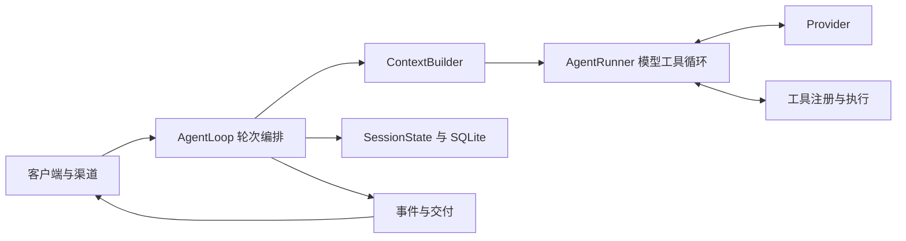

# 03 - 架构深入解析

> 已按本地 nanobot `0.4.1`、提交 `27f1a836b5c04a30763dd91960059f81c05bf505` 核对。核心源码使用中文 # 注释解读，配置示例单独标注。详见 [版本核对记录](../LOCAL_SOURCE_BASELINE.md)。

当前架构应按执行、状态和资源生命周期理解；原有静态行数、固定并发与纯 Markdown 会话描述不适用于本地基准。

## 目录

- [3.1 整体架构与边界](#section-3-1)
- [3.2 Loop、Runner 与实例数量](#section-3-2)
- [3.3 状态所有权与两种工作区](#section-3-3)
- [3.4 消息、事件与交付](#section-3-4)
- [3.5 注册、配置与基础设施](#section-3-5)
- [3.6 并发与安全](#section-3-6)
- [3.7 面试与验证](#section-3-7)

## 3.1 整体架构与边界

Python gateway 拥有执行、会话、工具、记忆和安全策略；WebUI、TUI 与聊天渠道是不同入口，不是各自独立的 Agent 引擎。教学分层不能替代实际所有权。

图是职责关系，省略命令、恢复、直接调用等适配分支，不是统一调用栈。

## 3.2 Loop、Runner 与实例数量

Loop 选择会话/项目并组织输入、运行、保存、交付；Runner 完成模型与工具循环。AgentLoop 初始化时创建并复用 self.runner，SubagentManager 另有自己的 Runner。一次消息、一次 run、一个对象和一个会话不同。

普通同会话处理有队列/锁，另有控制与输入注入；不同会话可在限制内并发。不能说每条消息新建 Runner，也不能从对象复用推导只能串行。

[nanobot/agent/loop.py](https://github.com/HKUDS/nanobot/blob/27f1a836b5c04a30763dd91960059f81c05bf505/nanobot/agent/loop.py) · [nanobot/agent/runner.py](https://github.com/HKUDS/nanobot/blob/27f1a836b5c04a30763dd91960059f81c05bf505/nanobot/agent/runner.py)

## 3.3 状态所有权与两种工作区

SessionState 管理运行时会话修改，SQLite 存规范消息和界面展示事实。MemoryStore 负责 Agent 自有资料/记忆文件，不代替数据库。项目工作区决定相对工具路径和项目 AGENTS.md，Agent 自有工作区保存 SOUL、USER、memory 和技能；选择项目不自动搬迁全部状态。

| 内容 | 当前默认位置 |
| --- | --- |
| 配置 | ~/.nanobot/config.json |
| 会话 | 配置目录 sessions/<workspace-id>/sessions.sqlite3 |
| 长期记忆 | Agent 工作区 memory/MEMORY.md |
| 整理来源 | Agent 工作区 memory/history.jsonl |

配置、存储和实例选择可由参数改变，以实际路径为准。

## 3.4 消息、事件与交付

MessageBus 有队列和本地订阅。publish 等待本地订阅者；publish_event 排队进行渠道交付。本地状态变化不等待外部网络发送。双队列不是“无限并发”或“直接水平扩展”的保证。

WebUIOutboundDelivery 管输出投影、流缓冲和完成状态；WebSocket 管连接顺序、背压和 drain。模型结果、已提交历史、客户端已显示不是同一时刻。

[nanobot/bus/queue.py](https://github.com/HKUDS/nanobot/blob/27f1a836b5c04a30763dd91960059f81c05bf505/nanobot/bus/queue.py) · [nanobot/webui/outbound_delivery.py](https://github.com/HKUDS/nanobot/blob/27f1a836b5c04a30763dd91960059f81c05bf505/nanobot/webui/outbound_delivery.py)

## 3.5 注册、配置与基础设施

Provider 元数据、路由与工厂分工；工具有 Tool 契约及注册表。配置是 Pydantic 校验的 config.json，不是教程原先展示的 nanobot.yml。应用组装处创建 MCPProvider，共享注册表，管理 connect/aclose，不由 Runner 每轮重建外部连接。

渐进披露可用来理解技能摘要/按需全文；不应把虚构的 save_memory 拦截或固定五行 YAML 作为当前机制。

## 3.6 并发与安全

正数 NANOBOT_MAX_CONCURRENT_REQUESTS 才创建请求 gate，并非固定 Semaphore(3)；没有该 gate 不意味着其他资源无上限。工具批次、会话锁与异步存储 owner 各保护不同边界。

路径范围、网络 SSRF 和操作系统沙箱不同。仅设置 cwd 或 Prompt 不构成隔离，正则黑名单也不是完备安全证明。取消会收敛任务，但不回滚任意已完成外部副作用。

## 3.7 面试与验证

解释一个普通问答和一个文件任务，标记输入、模型请求、工具 ID、状态和交付。读 test_loop_concurrency、test_runner_core 和 test_session_store，不背代码行数、平台数量或缓存百分比。

自查：谁真正执行工具？日志预览与历史正文有什么区别？会话存储为何不等于全部历史每次进入 Prompt？交付失败为何不能直接重做写文件？

## 下一章

[继续第 04 章](../04-source-code-walkthrough/README.md)
